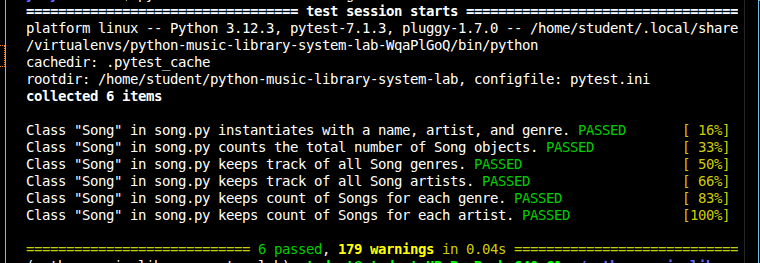

# Python Music Library System Lab

A Python `Song` class for MusicTech Innovations' music library. It represents individual songs and keeps library-wide statistics: total songs, unique artists and genres, and how many songs belong to each genre and artist.

## Features

- Create song objects with a name, artist, and genre
- Track the total number of songs created
- Keep a list of unique artists and unique genres
- Count songs per genre, e.g. `{"Rap": 5, "Rock": 1}`
- Count songs per artist, e.g. `{"Beyonce": 17, "Jay-Z": 40}`
- All tracking happens automatically when a new song is created

## The `Song` Class

**Instance attributes**

| Attribute | Description |
|-----------|-------------|
| `name`    | Title of the song |
| `artist`  | Artist who made the song |
| `genre`   | Genre of the song |

**Class attributes**

| Attribute      | Description |
|----------------|-------------|
| `count`        | Total number of songs created |
| `genres`       | List of unique genres |
| `artists`      | List of unique artists |
| `genre_count`  | Dictionary of songs per genre |
| `artist_count` | Dictionary of songs per artist |

**Class methods**

| Method                  | What it does |
|-------------------------|--------------|
| `add_song_to_count()`   | Increases `count` by 1 |
| `add_to_genres(genre)`  | Adds the genre to `genres` if it isn't already there |
| `add_to_artists(artist)`| Adds the artist to `artists` if it isn't already there |
| `add_to_genre_count(genre)`   | Increments the genre's count, or sets it to 1 if new |
| `add_to_artist_count(artist)` | Increments the artist's count, or sets it to 1 if new |

## Setup

1. Fork and clone the repository:
   ```bash
   git clone https://github.com/<your-username>/python-music-library-system-lab.git
   cd python-music-library-system-lab
   ```
2. Install dependencies and activate the virtual environment:
   ```bash
   pipenv install
   pipenv shell
   ```

## Usage

```python
from lib.song import Song

song1 = Song("99 Problems", "Jay-Z", "Rap")
song2 = Song("Halo", "Beyonce", "Pop")
song3 = Song("Empire State of Mind", "Jay-Z", "Rap")

print(Song.count)         # 3
print(Song.genres)        # ['Rap', 'Pop']
print(Song.artists)       # ['Jay-Z', 'Beyonce']
print(Song.genre_count)   # {'Rap': 2, 'Pop': 1}
print(Song.artist_count)  # {'Jay-Z': 2, 'Beyonce': 1}
```

## Running the Tests

```bash
pytest -v
```

### Screenshot of passing tests



## Project Structure

```
.
├── lib/
│   └── song.py        # Song class
├── testing/           # Test files
├── Pipfile
├── pytest.ini
└── README.md
```

## Author

Sharon Wanjiru